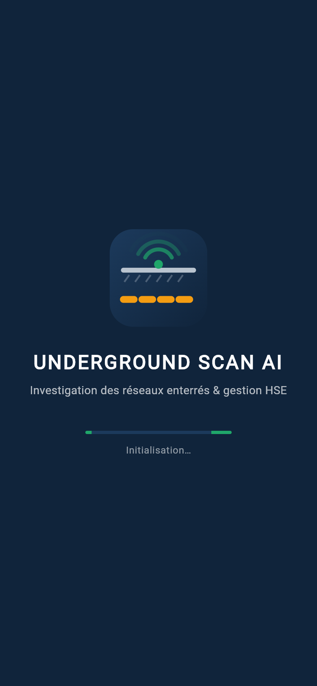
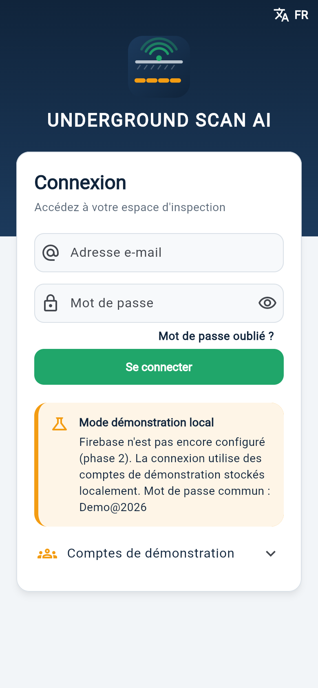
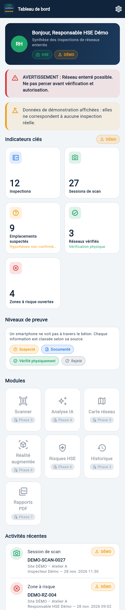
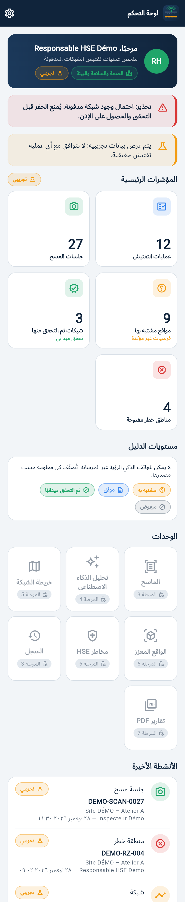
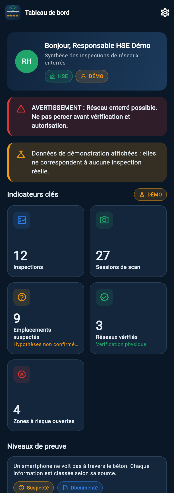
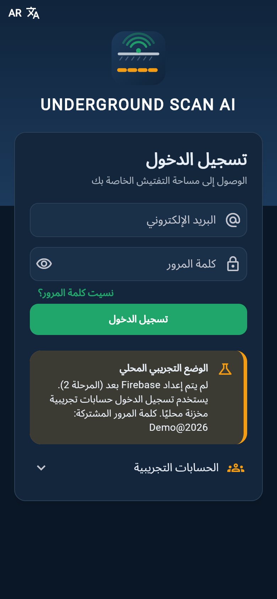

# UNDERGROUND SCAN AI

Flutter app (Android & iOS) that helps industrial maintenance and HSE teams **investigate, document, map and manage underground water pipelines** (PVC, PEHD, PPR) beneath concrete factory floors.

> **Physical limitation, stated up front:** a smartphone camera, GPS, AR or AI **cannot see through concrete**. The app never claims to detect buried pipes. Every piece of information is classified by evidence level:
>
> | Status | Meaning | Colour |
> |---|---|---|
> | `suspected` | AI or visual hypothesis, not confirmed | orange |
> | `documented` | imported from engineering drawings | blue |
> | `physically_verified` | confirmed on site (excavation, inspection camera, GPR…) | green |
> | `rejected` | investigated and ruled out | grey |

## Status: Phase 1 complete

| Done in Phase 1 | Notes |
|---|---|
| Project initialisation (Android, iOS, web for previews) | Flutter 3.50.1 / Dart 3.14 |
| Industrial theme, light + dark | Navy `#10243B`, green `#20A66A`, orange `#F39C12`, red `#D93636`, background `#F2F5F8` |
| French + Arabic localisation, full RTL | ARB files in `lib/l10n/`, switchable before and after login |
| Animated splash screen | Restores the session, then routes to login or dashboard |
| Login screen with validation and loading/error states | **Local demo auth** until Firebase arrives in Phase 2 (see below) |
| Forgot-password screen | In demo mode it says plainly that the feature needs Firebase. It does not pretend an e-mail was sent. |
| Dashboard | Indicators, HSE drilling warning, evidence-level legend, module grid, recent activities |
| Settings | Language, theme, demo-data toggle, sign-out with confirmation |
| Route guard | Protected routes redirect to login |

### Honesty rules applied in the code
- **No fake buttons.** Modules not built yet (Scanner, AI, Map, AR, HSE, History, Reports) appear on the dashboard **disabled** and labelled with their planned phase.
- **No fake data by default.** The dashboard shows real values, which are zero today. Sample data appears only when *Settings → Demo data* is switched on, and then every item carries a DEMO badge and banner. All demo references start with `DEMO-`.
- **Demo authentication is labelled.** `LocalDemoAuthRepository` holds 4 public demo accounts (one per role, shared password `Demo@2026`) and the login screen says so. It gives access to local demo content only. Phase 2 replaces it with Firebase behind the same `AuthRepository` interface.

| Demo account | Role |
|---|---|
| `admin@demo.local` | Administrator |
| `maintenance@demo.local` | Maintenance |
| `hse@demo.local` | HSE |
| `inspecteur@demo.local` | Inspector |

## Screenshots

| Splash | Login (FR) | Dashboard, demo data (FR) | Dashboard (AR, RTL) | Dark | Login (AR, dark) |
|---|---|---|---|---|---|
|  |  |  |  |  |  |

## Architecture

The code is organised by feature, with layers inside each feature: **presentation → application (Riverpod state) → repositories (interfaces) → models**. The UI never talks to a backend directly. It depends on repository interfaces, so Firebase (Phase 2) and later a GPR device integration can be plugged in without touching the screens.

```
lib/
  main.dart                    # bootstraps SharedPreferences + ProviderScope
  app/
    app.dart                   # MaterialApp.router, themes, locales
    routes.dart                # go_router + auth redirect guard
    theme.dart                 # AppColors, light/dark ThemeData
  core/
    constants/                 # app-wide constants
    services/                  # PreferencesService (local settings)
    utils/                     # validators, l10n extensions
    widgets/                   # AppLogo, NoticeBanner, Pill/DemoBadge, LanguageSwitcher
    demo/                      # DEMO data (opt-in, flagged)
  models/                      # AppUser/UserRole, VerificationStatus, DashboardSnapshot
  repositories/                # AuthRepository (+ LocalDemo impl), DashboardRepository
  features/
    authentication/            # splash, login, forgot password, auth providers
    dashboard/                 # dashboard screen + widgets, providers
    settings/                  # settings screen + controller
    scanner/ ai_analysis/ network_map/ ar_visualization/
    hse_risk/ history/ reports/   # added in later phases
  l10n/                        # app_fr.arb (template), app_ar.arb + generated code
```

**Tech choices:**
- `flutter_riverpod` 3 for state and dependency injection; repositories are swapped through provider overrides.
- `go_router` for declarative routing with an auth redirect.
- `shared_preferences` for local, non-sensitive settings.
- `intl` + `flutter gen-l10n` for localisation.
- `material_ui`, Flutter's Material package. `package:flutter/material.dart` is deprecated since Flutter 3.47.

## Roadmap

| Phase | Scope |
|---|---|
| **1** ✅ | Project setup, theme, splash, login, dashboard, FR/AR, settings |
| 2 | Firebase project setup (`flutterfire configure`), Firebase Auth + roles (custom claims), Firestore models for every collection (`users`, `sites`, `scan_sessions`, `scan_images`, `pipe_networks`, `pipe_segments`, `risk_zones`, `inspections`, `corrective_actions`, `reports`) with id / created_at / created_by / updated_at / site_id, security rules, Storage, audit trail |
| 3 | Camera scanner (photo, video, flashlight), scan sessions, GPS + timestamp, manual image annotation, history |
| 4 | AI visual analysis (on-device model for visible surface evidence: covers, manholes, repairs, cracks, stains, markings) with confidence scores. Results are stored as `suspected` hypotheses only. |
| 5 | Network map: Google Maps outdoors, local coordinate system with reference points indoors, route drawing, material/diameter/documented depth, drawing import |
| 6 | AR overlays (ARCore/ARKit) for markers and recorded routes, colour-coded by status; HSE module (no-drill zones, risk classes, corrective actions, deadlines, validation) |
| 7 | PDF reports with signatures, tests, performance, store deployment |

## Development

```bash
flutter pub get
flutter gen-l10n        # also runs automatically on build
flutter analyze         # expected: No issues found
flutter test            # 23 unit + widget tests
flutter run             # on a device / emulator
```

The tests cover validators, the demo auth repository, the dashboard repository (demo data always flagged), the full login → dashboard → settings → sign-out flow, route guarding, Arabic RTL, the honest forgot-password behaviour, and overflow checks on a 360 px phone in French and Arabic.
